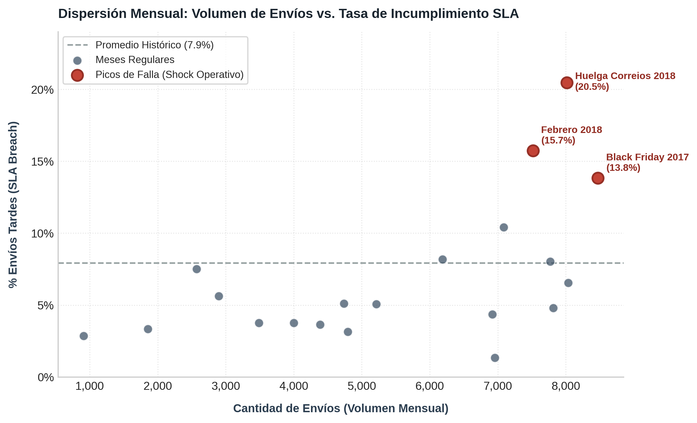
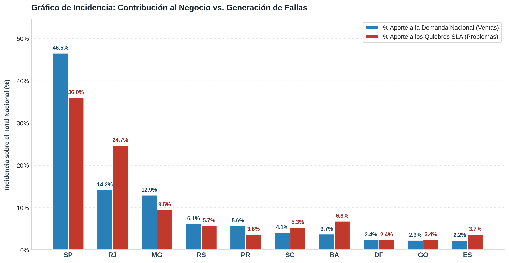
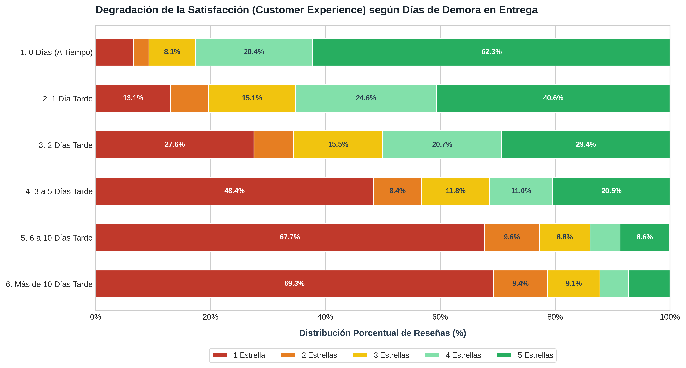


# Olist E-Commerce: Diagnóstico Operativo y Análisis de Cuellos de Botella Logísticos

> Análisis diagnóstico sobre +109k entregas para identificar la causa raíz de las rupturas de SLA (Service Level Agreement), evidenciar la inelasticidad operativa de la red y cuantificar su impacto directo en la satisfacción y retención de clientes.

## El Problema de Negocio

Los incumplimientos en los tiempos de entrega (SLA) de Olist impactan directamente en las calificaciones públicas y la reputación de la plataforma.

El objetivo de este proyecto es auditar la operación logística para transicionar de una estadística descriptiva a un diagnóstico de causa raíz. Para ello, el análisis responde tres preguntas clave:

1. ¿Las demoras representan una ineficiencia crónica del sistema o reflejan una falta de elasticidad operativa ante picos de demanda y disrupciones externas?
2. ¿En qué etapas geográficas se concentran las fallas estructurales y sobre qué actor recae la responsabilidad técnica (vendedor vs. transportista)?
3. ¿Cuál es el umbral temporal exacto de tolerancia del cliente antes de que la satisfacción colapse a niveles críticos para la retención?

## Arquitectura y Modelado de Datos

El análisis se estructuró sobre cinco tablas transaccionales de Olist: `orders`, `order_items`, `customers`, `sellers` y `order_reviews`.

Operar directamente sobre las tablas crudas genera sesgos de duplicación, ya que una orden puede incluir múltiples productos enviados por distintos vendedores desde diferentes estados. Para asegurar la consistencia analítica, se construyó una tabla de hechos dimensional (`fct_order_deliveries`) a nivel de **ítem/paquete**, incorporando:

* **Métricas de Ciclo Logístico:** Varianza en días entre la entrega real y la fecha prometida de SLA (`sla_variance_days`).
* **Banderas de SLA:** Identificación binaria de quiebre de promesa (`is_sla_breach`).
* **Modelo de Atribución Técnico:** Lógica condicional cruzada que aísla demoras de despacho del vendedor (`is_late_seller_dispatch`) frente a demoras de tránsito del transportista (`is_late_carrier_transit`).
* **Filtros de Integridad y Calidad:** Exclusión del año 2016 por volumen no representativo y depuración de registros con inconsistencias cronológicas en marcas de tiempo.

## Hallazgos Principales

### 1. El benchmark histórico y la inelasticidad ante shocks operativos

Al evaluar la totalidad de la operación (+109k entregas), la plataforma exhibe una tasa histórica de incumplimiento de SLA del **7.94%**. El modelo de atribución inicial revela que la fricción técnica se concentra mayoritariamente en la red de transporte:

| Volumen Total | Tasa SLA Breach (Fallas) | Responsabilidad Vendedor | Responsabilidad Transportista | Responsabilidad Compartida |
| :--- | :--- | :--- | :--- | :--- |
| 109,640 | **7.94%** | 11.98% | **71.65%** | 16.37% |

Sin embargo, evaluar la logística mediante un promedio estático enmascara la realidad del sistema. Al cruzar el volumen mensual contra la tasa de incumplimiento, los datos demuestran que **la red no es crónicamente ineficiente, sino inelástica**:

*(Gráfico: Dispersión mensual de volumen de envíos vs. tasa de falla de SLA con benchmark promedio).*

* **Operación Regular Controlada:** En meses estándar (volúmenes de hasta 6.000 pedidos), la tasa de fallas se mantiene estable entre el **3% y el 5%**, holgadamente por debajo del benchmark histórico.
* **Puntos Críticos de Estrés:** Cuando el volumen supera los 7.000 envíos o coinciden eventos de fricción externa, la red se satura exponencialmente:
  * **Black Friday 2017 (13.8%):** Pico puro de sobredemanda transaccional.
  * **Febrero 2018 (15.7%):** Fricción por feriados de Carnaval combinada con el inicio del conflicto postal.
  * **Huelga de Correios Marzo 2018 (20.5%):** Colapso máximo de tránsito por disrupción del operador logístico principal.

### 2. Aislamiento geográfico y el cuello de botella en la última milla

Un análisis *top-down* descarta que las fallas provengan de una saturación en la recolección en origen. A pesar de que el estado de São Paulo concentra el **71.37%** de los despachos nacionales, su tasa de fallas se mantiene alineada a la media:

| Estado Origen (Despacho) | Cuota de Volumen Nacional | Tasa de Falla General (SLA Breach) |
| :--- | :--- | :--- |
| **SP (São Paulo)** | **71.37%** | **8.55%** |
| MG (Minas Gerais) | 7.80% | 5.57% |
| PR (Paraná) | 7.69% | 6.44% |
| RJ (Río de Janeiro) | 4.23% | 8.19% |

El quiebre estructural se manifiesta en la **distribución final (última milla)** al contrastar el aporte de cada estado a la demanda frente a su contribución real a los quiebres de entrega. Al analizar la incidencia relativa sobre los principales destinos, se observan dos polos opuestos:

* **Efecto Amortiguador (São Paulo):** SP tracciona casi la mitad del volumen concentrado (**46.7%**), pero es responsable de una proporción significativamente menor de los problemas (**35.9%** de los quiebres de SLA), ayudando a sostener el rendimiento global del sistema.
* **Sobrerrepresentación Crítica (Río de Janeiro):** RJ representa solo el **14.2%** de las entregas, pero genera casi una cuarta parte (**24.6%**) de todas las fallas operativas de la red. Su cuota de problemas supera en más de 10 puntos porcentuales a su cuota de negocio.

*(Gráfico de Incidencia: Contraste directo entre el volumen de demanda aportado al negocio [azul] versus la cuota de quiebres de SLA generados [rojo]).*

Al profundizar a nivel de corredor logístico interestatal, la ruta **São Paulo ➔ Río de Janeiro** confirma ser el principal cuello de botella de la plataforma: el **93.57%** de los retrasos en este tramo recaen exclusivamente en la logística de tránsito y distribución local en destino, evidenciando una capacidad de transporte saturada.

### 3. Degradación de la experiencia: El impacto crítico en la retención

Al cruzar los tramos de demora efectiva con las reseñas de satisfacción de los clientes, se comprueba que la tolerancia del usuario no se erosiona de forma gradual, sino mediante caídas abruptas:

* **Entrega a Tiempo:** El **65.0%** de los clientes otorga 5 estrellas, mientras que las reseñas negativas de 1 estrella se limitan a un **8.5%**.
* **El Umbral de Tolerancia (Días 3 a 5):** A partir del tercer día de retraso la percepción se desploma: las calificaciones de 5 estrellas caen al 15.0% y las valoraciones de 1 estrella se disparan al **48.3%**.
* **Deterioro Severo (>6 Días):** Pasada una semana de demora, más del **70%** califica con 1 estrella, anulando las probabilidades de recompra y dañando severamente el Customer Lifetime Value (LTV).

## Conclusiones y Recomendaciones Estratégicas

1. **Gestión de Capacidad ante Shocks:** La red logística rinde de forma óptima bajo condiciones normales, pero carece de amortiguadores operativos ante picos de demanda o eventos externos. Se deben prever contratos de transporte de refuerzo (*overflow logistics*) para temporadas altas.
2. **Descentralización de la Última Milla en RJ:** Dado que el 93.5% de los retrasos hacia Río de Janeiro corresponden al transportista, es prioritario diversificar operadores locales o establecer centros de consolidación intermedios que eviten el traspaso exclusivo por Correios.
3. **Regla Operativa de Retención (Ventana de 48h):** El cliente tolera hasta 2 días de desvío de SLA con penalizaciones moderadas. Superar los **3 días de atraso** detona el quiebre de confianza; la plataforma debe implementar compensaciones proactivas automáticas antes de alcanzar ese límite.

## Estructura del Repositorio

* `sql/`
  * `00_create_fct_order_deliveries.sql`: DDL, limpieza de datos y modelado dimensional.
  * `01_tasa_global_sla.sql`: Benchmark histórico nacional y matriz de atribución.
  * `02_evolucion_temporal_sla.sql`: Extracción de volumen mensual y tasas de quiebre.
  * `03_volumen_por_origen.sql`: Análisis de concentración y despacho en origen.
  * `04_cuello_de_botella_destino.sql`: Rendimiento de última milla por estado destino.
  * `05_analisis_relacional_corredores.sql`: Evaluación técnica del corredor SP ➔ RJ.
  * `06_estandar_historico_reviews.sql`: Benchmark global de calificaciones y reseñas.
  * `07_degradacion_satisfaccion_tramos.sql`: Matriz de satisfacción según tramos de retraso.
* `Notebook/`
  * `images/`
    * `scatter_volumen_vs_sla.png`: Dispersión de volumen vs. fallas de SLA (Inelasticidad).
    * `last_mile_bottlenecks.png`: Matriz de concentración vs. falla en última milla.
    * `barras_apiladas_cx.png`: Distribución de reseñas según días de demor
